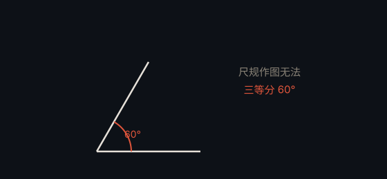

# 三等分角 · Angle Trisection

> **状态**：已解决（不可行，Wantzel，1837） · **提出**：古希腊

## 问题

仅用尺规（无刻度直尺 + 圆规），能否把任意角三等分？

## 结论

**不可行**。Pierre Wantzel 于 1837 年证明：60° 角无法仅用尺规三等分，故一般角的三等分不可能。

## 通俗解释

尺规作图能构造的数，本质上是「加减乘除与开平方」能表达的数；而三等分 60° 需要解一个三次方程，其解一般无法用这些运算表示，因此不可行。

## 为什么重要

它与「倍立方」「化圆为方」并称古希腊三大尺规作图难题，最终都靠代数工具（域扩张理论）证明其不可能性。

---

← [返回目录](../README.md)
