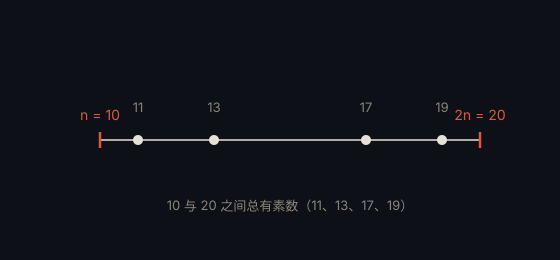

# 伯特兰公设 · Bertrand's Postulate

> **状态**：定理（Chebyshev，1850） · **提出**：1845 年 · **提出者**：Joseph Bertrand

## 定理

对任意整数 $n > 1$，在 $n$ 与 $2n$ 之间至少存在一个素数。

## 通俗解释

随便取一个数，把它翻倍，这个区间里一定藏着一个素数。

## 为什么重要

它给出了素数密度的一个「可证明」的下界，常作为素数定理的初等替代；也是许多数论证明中的得力工具。

## 具体例子

- $n=10$：10 与 20 之间有 11、13、17、19

## 进展

1850 年 Chebyshev 首次证明；1919 年 Ramanujan 给出简洁证明，Paul Erdős 后来也给出过著名的初等证明。

---

← [返回目录](../README.md)
