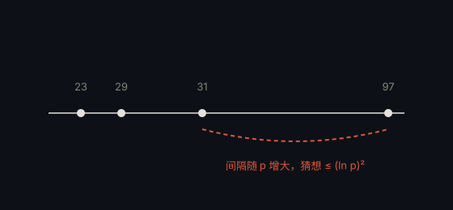

# 克拉梅尔猜想 · Cramér's Conjecture

> **状态**：未解决 · **提出**：1936 年 · **提出者**：Harald Cramér

## 精确陈述

设 $p_n$ 为第 $n$ 个素数，相邻素数间隔为 $g_n = p_{n+1} - p_n$。**猜想**：

$$\limsup_{n \to \infty} \frac{g_n}{(\ln p_n)^2} = 1$$

即最大素数间隔约为 $(\ln p)^2$ 的量级。

## 通俗解释

素数越往大走越稀疏，但它们之间的「缝隙」能有多大？克拉梅尔猜想说：最大缝隙大约是「位数的平方」量级——不会更夸张。

## 为什么重要

它给出了素数间隔的最优上界猜想，是素数分布「随机性 vs 结构性」之争的核心问题之一。

---

← [返回目录](../README.md)
