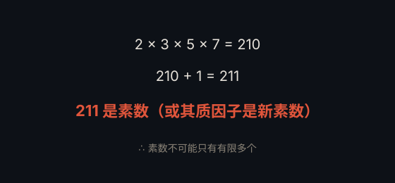

# 素数无穷多 · Infinitude of Primes

> **状态**：定理（Euclid，约公元前 300 年） · **提出者**：Euclid

## 定理

存在无穷多个素数。

## 证明（反证法）

假设素数只有有限多个 $p_1, p_2, \dots, p_k$。考虑

$$N = p_1 p_2 \cdots p_k + 1$$

$N$ 不被任何 $p_i$ 整除（余 1），故 $N$ 要么本身是素数，要么含有一个不在列表中的素因子——矛盾。

## 通俗解释

把所有素数乘起来再加 1，得到的新数不能被其中任何一个整除，所以必然「逼出」一个全新的素数。因此素数永远数不完。

## 为什么重要

这是数学史上最优雅的证明之一，也是数论的起点。

---

← [返回目录](../README.md)
