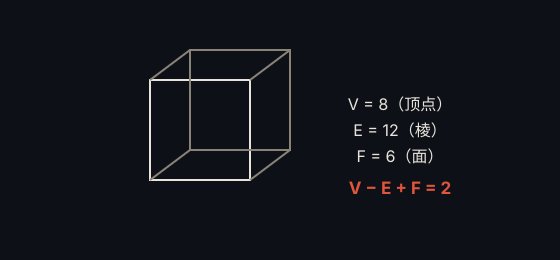

# 欧拉多面体公式 · Euler's Polyhedron Formula

> **状态**：定理 · **提出**：1750 年 · **提出者**：Leonhard Euler

## 精确陈述

对任意凸多面体，设 $V$ 为顶点数、$E$ 为棱数、$F$ 为面数，则

$$V - E + F = 2$$

## 通俗解释

无论多面体长什么样，只要它是「球面型」的（没有洞），顶点数减棱数加面数，永远等于 2。

## 为什么重要

它是拓扑学与组合几何的起点，欧拉示性数 $\chi = V - E + F$ 成为贯穿几何与拓扑的核心不变量。

## 具体例子

- 立方体：$8 - 12 + 6 = 2$
- 正四面体：$4 - 6 + 4 = 2$

## 进展

已推广到任意曲面：$V - E + F = \chi$（欧拉示性数），成为拓扑学基本工具。

---

← [返回目录](../README.md)
