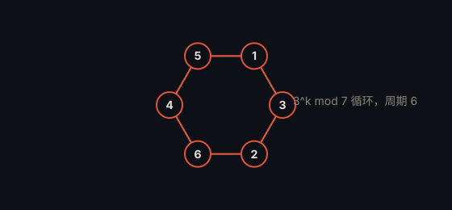

# 费马小定理 · Fermat's Little Theorem

> **状态**：定理 · **提出**：1640 年 · **提出者**：Pierre de Fermat

## 精确陈述

若 $p$ 是素数，且整数 $a$ 不被 $p$ 整除，则

$$a^{p-1} \equiv 1 \pmod p$$

等价地，对任意整数 $a$，有 $a^p \equiv a \pmod p$。

## 通俗解释

一个素数 $p$ 会让「幂运算」出现周期：任何与 $p$ 互素的数的 $p-1$ 次方，除以 $p$ 都余 1。

## 为什么重要

它是现代密码学（RSA）、素性检验（Fermat 检验）与模算术的基石，也是欧拉定理的特例。

## 具体例子

取 $p=7$、$a=3$：$3^{6} = 729 = 7 \times 104 + 1$，即 $3^6 \equiv 1 \pmod 7$。

## 进展

1736 年 Euler 给出首个证明；后来有多种简洁证明（如组合计数、群论证明）。

---

← [返回目录](../README.md)
