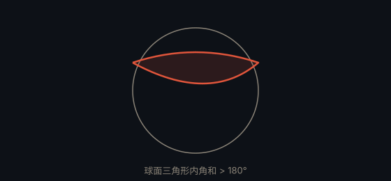

# 高斯-邦内定理 · Gauss–Bonnet Theorem

> **状态**：定理 · **提出**：1848 年 · **提出者**：Carl Friedrich Gauss & Pierre Ossian Bonnet

## 精确陈述

对一个紧致的二维曲面 $M$，其高斯曲率 $K$ 在整个曲面上的积分满足

$$\int_M K \, dA = 2\pi \chi(M)$$

其中 $\chi(M)$ 是欧拉示性数。

## 通俗解释

曲面的「总弯曲程度」（曲率积分）完全由它的「拓扑」决定——具体说，由「洞」的个数决定。无论你怎么弯折一个球面，它的总曲率始终是 $4\pi$（对应欧拉示性数 2）。

## 为什么重要

它把「几何量」（曲率）与「拓扑量」（欧拉示性数）精确挂钩，是微分几何最重要的定理之一，也是陈省身-高斯-邦内定理（高维推广）的起点。

## 具体例子

- 球面：$\chi = 2$，总曲率 $4\pi$。
- 环面：$\chi = 0$，总曲率 $0$。

---

← [返回目录](../README.md)
