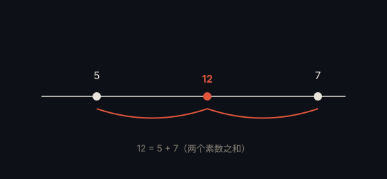

# 哥德巴赫猜想 · Goldbach's Conjecture

> **状态**：未解决 · **提出**：1742 年 · **提出者**：Christian Goldbach

## 精确陈述

**猜想**：每个大于 2 的偶数都可以写成两个素数之和。

即对任意偶数 $n > 2$，存在素数 $p, q$ 使得

$$n = p + q$$

## 通俗解释

一个偶数能否总是拆成两个「不可再拆」的数（素数）相加？目前看似乎总是可以，但没人能证明对所有偶数都成立。

## 为什么重要

这是加法数论最著名的问题，触及素数在「加法结构」下的行为——与乘法的唯一分解相比，加法的规律远为神秘。

## 具体例子

- $4 = 2 + 2$
- $6 = 3 + 3$
- $8 = 3 + 5$
- $10 = 3 + 7 = 5 + 5$
- $100 = 3 + 97 = 11 + 89 = \dots$

## 进展

陈景润 1973 年证明了「每个充分大的偶数可写成一个素数与至多两个素数乘积之和」（1+2），是迄今最接近的结果。弱哥德巴赫猜想（每个大于 5 的奇数是三个素数之和）已于 2013 年由 Harald Helfgott 证明。

---

← [返回目录](../README.md)
