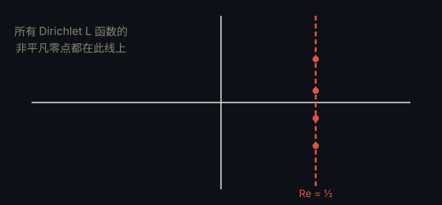

# 广义黎曼猜想 · Generalized Riemann Hypothesis

> **状态**：未解决 · **提出**：约 1884 年（Adolf Piltz 提出，后经 Landau 等系统化）

## 精确陈述

对每个 Dirichlet L 函数 $L(s, \chi)$，其所有非平凡零点都位于临界线 $\mathrm{Re}(s) = \frac{1}{2}$ 上。

## 通俗解释

黎曼猜想只针对「黎曼 ζ 函数」这一个函数；广义黎曼猜想把它推广到一整族 L 函数，断言它们的零点也都整齐地排在实部 1/2 这条线上。

## 为什么重要

数论中大量结论（如素数在算术级数中的分布、许多算法的最优性）都以 GRH 为假设前提；若它成立，众多「条件性」结果将同时成立。

---

← [返回目录](../README.md)
