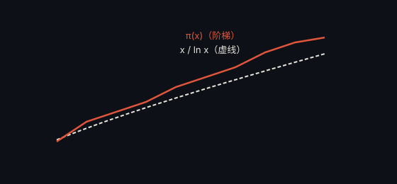

# 素数定理 · Prime Number Theorem

> **状态**：已解决（1896） · **提出**：约 1798 年（Gauss 与 Legendre 猜测）

## 精确陈述

设 $\pi(x)$ 为不超过 $x$ 的素数个数。则当 $x \to \infty$ 时：

$$\pi(x) \sim \frac{x}{\ln x}$$

即 $\pi(x)$ 与 $x / \ln x$ 的比值趋于 1。

## 通俗解释

素数在整数中大约「每隔 $\ln x$ 个」出现一个。$x$ 越大，这个估计越精确。

## 为什么重要

它是素数分布最基础的定量规律。黎曼猜想可视为它的「精细版」——黎曼猜想要给出这一估计的最优误差上界。

## 具体例子

- $x = 100$：$\pi(100) = 25$，$100/\ln 100 \approx 21.7$
- $x = 1000$：$\pi(1000) = 168$，$1000/\ln 1000 \approx 144.8$

## 进展

1896 年 Hadamard 与 de la Vallée Poussin 各自独立证明，都借助了黎曼 ζ 函数的性质。

---

← [返回目录](../README.md)
