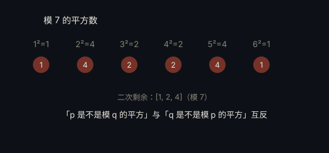

# 二次互反律 · Quadratic Reciprocity

> **状态**：定理 · **提出**：约 1796 年 · **提出者**：Carl Friedrich Gauss

## 精确陈述

对奇素数 $p, q$，有

$$\left(\frac{p}{q}\right)\left(\frac{q}{p}\right) = (-1)^{\frac{(p-1)(q-1)}{4}}$$

其中 $\left(\frac{p}{q}\right)$ 是勒让德符号（判断 $p$ 是否为模 $q$ 的二次剩余）。

## 通俗解释

「$p$ 是否为模 $q$ 的平方数」与「$q$ 是否为模 $p$ 的平方数」之间，存在一个精妙且简单的联系，只取决于 $p,q$ 除以 4 的余数。

## 为什么重要

高斯称之为「黄金定理」，是数论最核心的工具之一，也是现代「互反律」家族（阿廷互反律等）的起点。

## 进展

高斯一生给出 8 个证明；后被推广为更高次的互反律与类域论。

---

← [返回目录](../README.md)
