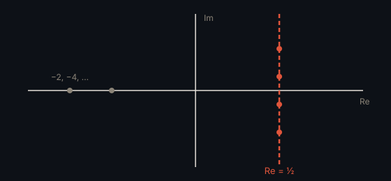

# 黎曼猜想 · Riemann Hypothesis

> **状态**：未解决 · **提出**：1859 年 · **提出者**：Bernhard Riemann

## 精确陈述

黎曼 ζ 函数在 $\mathrm{Re}(s) > 1$ 时定义为：

$$\zeta(s) = \sum_{n=1}^{\infty} \frac{1}{n^s} = \prod_{p\ \text{素数}} \frac{1}{1 - p^{-s}}$$

**猜想**：ζ(s) 的所有非平凡零点（即除去负偶数 −2, −4, −6, … 之外的零点）都位于临界线

$$\mathrm{Re}(s) = \frac{1}{2}$$

上。

## 通俗解释

素数是整数的「原子」。黎曼猜想断言：素数在整数中分布的「误差项」不会比 $\sqrt{x}\ln x$ 这个量级更差——即素数分布遵循一种最优的规律，不存在更大的隐藏偏差。

## 为什么重要

素数分布是数论的核心，也与现代密码学（RSA 等依赖大素数）以及量子混沌有深刻联系。它是千禧年七大难题之一。

## 具体例子

前几个非平凡零点近似为 $s = \frac{1}{2} + 14.1347\dots i$、$\frac{1}{2} + 21.0220\dots i$、$\frac{1}{2} + 25.0108\dots i$ ——实部都是 $\frac{1}{2}$。

## 进展

已用计算机验证前 $10^{13}$ 个零点都位于临界线上，但一般性证明仍未找到。

---

← [返回目录](../README.md)
