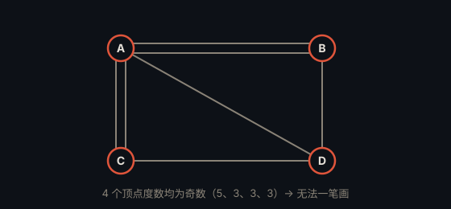

# 柯尼斯堡七桥问题 · Seven Bridges of Königsberg

> **状态**：已解决（Euler，1736） · **提出**：1736 年 · **提出者**：Leonhard Euler

## 问题

柯尼斯堡城有一条河，河中有两个小岛，七座桥连接两岸与两岛。**问题**：能否从某处出发，恰好走过每座桥一次，再回到起点？

## 精确陈述

把四块陆地看作顶点 A、B、C、D，七座桥看作边。问题等价于：这个图是否存在欧拉回路（一笔画遍历每条边恰一次）。

## 通俗解释

欧拉证明：一个图能一笔画遍历所有边，当且仅当「度数为奇数的顶点」不超过两个。柯尼斯堡的四个顶点度数分别是 5、3、3、3——全是奇数，所以**不可能**一笔画。

## 为什么重要

这是**图论**的诞生之作。欧拉把「走路」抽象成「图」，开创了一个全新的数学分支。

---

← [返回目录](../README.md)
