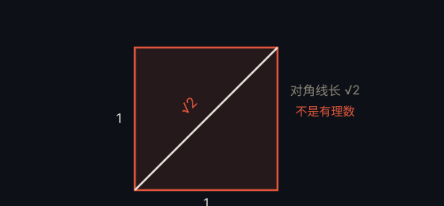

# √2 的无理性 · Irrationality of √2

> **状态**：定理（古希腊毕达哥拉斯学派） · **提出**：公元前 5 世纪

## 定理

$\sqrt{2}$ 是无理数，即不能写成两个整数之比 $\frac{a}{b}$。

## 证明（反证法）

假设 $\sqrt{2} = \frac{a}{b}$，其中 $a, b$ 为互素整数。则 $a^2 = 2b^2$，故 $a^2$ 为偶数，进而 $a$ 为偶数，设 $a = 2k$。代入得 $4k^2 = 2b^2$，即 $b^2 = 2k^2$，故 $b$ 也为偶数——与 $a, b$ 互素矛盾。

## 通俗解释

正方形对角线与边长「不可公度」——无法用同一把尺子同时精确量出两者。这是数学史上第一个被证明的「无理数」，曾深刻震撼古希腊数学。

## 为什么重要

它开启了「无理数」的研究，是「归谬法」（反证法）最经典的范例。

---

← [返回目录](../README.md)
