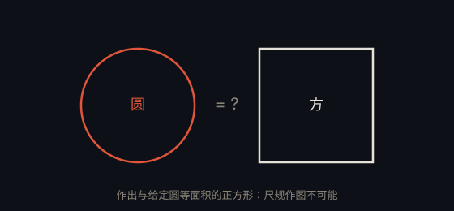

# 化圆为方 · Squaring the Circle

> **状态**：已解决（不可行，Lindemann，1882） · **提出**：古希腊

## 问题

仅用尺规，能否作出一个正方形，使其面积等于给定圆的面积？

## 结论

**不可行**。Ferdinand von Lindemann 于 1882 年证明 $\pi$ 是超越数，从而 $\sqrt{\pi}$ 无法用尺规作图构造。

## 通俗解释

圆面积为 $\pi r^2$，等面积正方形的边长为 $r\sqrt{\pi}$。而 $\pi$ 是超越数（不是任何整系数多项式方程的根），尺规作图只能构造「代数数」，因此 $\sqrt{\pi}$ 无法用尺规作出。

## 为什么重要

它最终证明了「化圆为方」在数学上不可能，也是证明 $\pi$ 超越性的直接应用，与三等分角、倍立方并称古希腊三大难题。

---

← [返回目录](../README.md)
